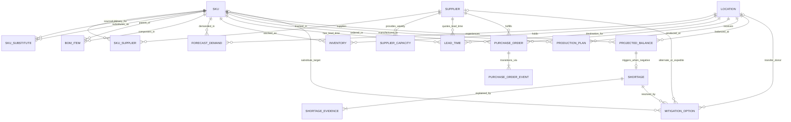

# Entity-Relationship Model & Lifecycle Design

## Mermaid ER Diagram



## Cardinality & Optionality Matrix

| Parent | Child / Bridge | Cardinality | Optional? | Foreign Key(s) |
|---|---|---:|---|---|
| `SKU` | `Supplier` via `sku_suppliers` | N:M | No | `sku_id`, `supplier_id` |
| `SKU` | `SKU` via `sku_substitutes` | N:M | Yes | `sku_id`, `substitute_sku_id` |
| `SKU` | `SKU` via `bom_items` | N:M | Yes (MAKE/BOTH only) | `parent_sku_id`, `component_sku_id` |
| `SKU`, `Location` | `ForecastDemand` | 1:N | No | `sku_id`, `location_id` |
| `SKU`, `Location` | `Inventory` | 1:1 per pair | No | `sku_id`, `location_id` |
| `Supplier` | `SupplierCapacity` | 1:N (52 weeks) | No | `supplier_id` |
| `SKU`, `Supplier`, `Location` | `LeadTime` | 1:N | No | `sku_id`, `supplier_id`, `location_id` |
| `PurchaseOrder` | `PurchaseOrderEvent` | 1:N (append-only) | No | `po_id` |
| `ProjectedBalance` | `Shortage` | 1:0..1 | Yes (deficit onset only) | `balance_id` |
| `Shortage` | `ShortageEvidence` | 1:N (>= 2 rows) | No | `shortage_id` |
| `Shortage` | `MitigationOption` | 1:N (1..4 ranked) | No | `shortage_id` |

## Effective Dates & History Preservation

- Every entity carries `effective_from` (required ISO date) and `effective_to` (optional, `>= effective_from`).
- `purchase_order_events` is strictly append-only (`sequence_num = 1..k`, non-decreasing UTC timestamps). `purchase_orders.current_status` is derived directly from the latest event's `to_status` and never overwritten without an audit event.

## PurchaseOrder State Machine

```text
NULL -> CREATED -> CONFIRMED -> IN_TRANSIT -> RECEIVED
                |            |             \-> DELAYED -> RECEIVED | IN_TRANSIT | CANCELLED
                \-> CANCELLED \-> DELAYED / CANCELLED
```
